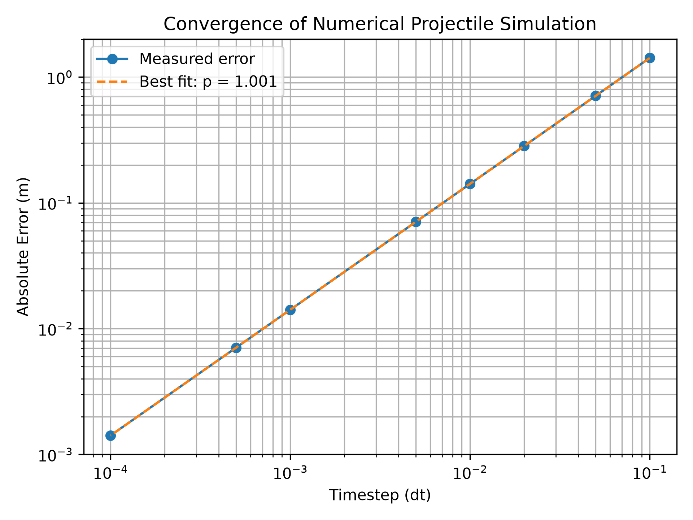
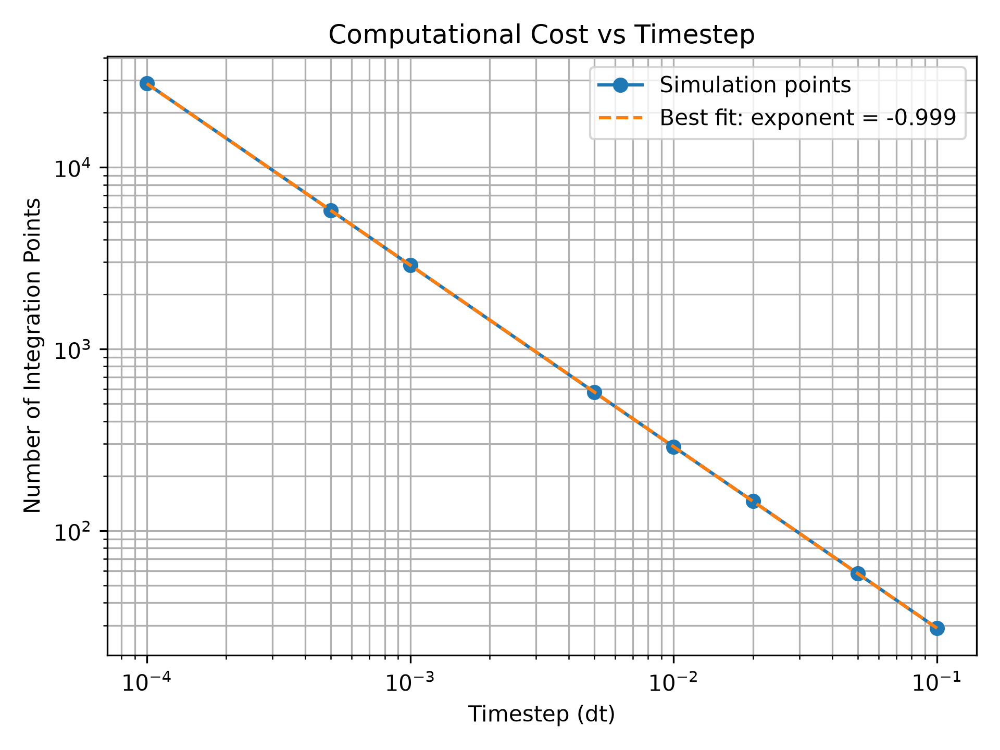
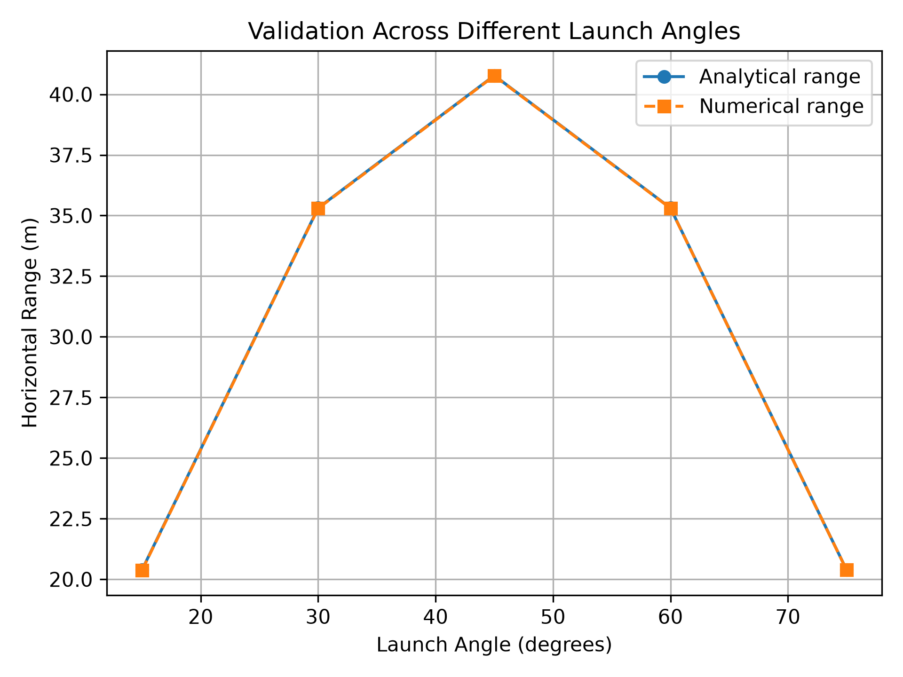

# Projectile Motion: Numerical Simulation and Analysis

A Python-based computational investigation of projectile motion, combining an interactive visualiser with numerical analysis of timestep accuracy, convergence, computational cost, and model validation.

## Overview

This project started as an interactive 2D projectile-motion visualiser and developed into a computational investigation of numerical accuracy and efficiency.

The main question investigated was:

> **How does timestep size affect the accuracy and computational cost of a numerical projectile-motion simulation?**

The numerical results are compared against the analytical solution for ideal projectile motion. The simulation is also tested across multiple launch angles to check whether it reproduces the expected behaviour of the physical model.

## Features

* Interactive 2D projectile trajectory visualisation
* Adjustable initial velocity and launch angle
* Numerical time-stepping simulation
* Linear interpolation at ground crossing
* Analytical calculation of projectile range
* Convergence analysis across multiple timestep sizes
* Computational-cost analysis
* Validation across different launch angles
* Automatic generation of figures and CSV results

## Physics Model

The simulation assumes ideal projectile motion:

* No air resistance
* Constant gravitational acceleration
* Flat ground
* Constant horizontal velocity
* Uniform gravitational acceleration

For an initial velocity \(v_0\) and launch angle \(\theta\), the theoretical horizontal range is

$$
R = \frac{v_0^2\sin(2\theta)}{g}
$$

where \(g = 9.81\,\text{m/s}^2\).

This analytical result provides a reference against which the numerical simulation can be evaluated.

## Numerical Method

The simulation advances the projectile in small timesteps.

At each timestep:

1. The vertical velocity is updated using gravitational acceleration.
2. The horizontal and vertical positions are updated.
3. The simulation checks whether the projectile has crossed the ground.
4. When the trajectory crosses \(y=0\), linear interpolation between the final two points estimates the landing position.

The interpolation step reduces the error caused by stopping only after the projectile has already moved below the ground.

## Numerical Investigation

### 1. Convergence Analysis

The simulation was tested using timestep sizes ranging from `0.1` to `0.0001` seconds.

The main experiment used:

| Parameter                  |           Value |
| -------------------------- | --------------: |
| Initial velocity           |          20 m/s |
| Launch angle               |             45° |
| Gravitational acceleration |       9.81 m/s² |
| Analytical range           | 40.7747196738 m |

The numerical results were:

| Timestep | Numerical Range (m) | Absolute Error (m) |
| -------: | ------------------: | -----------------: |
|      0.1 |       39.3532329284 |       1.4214867454 |
|     0.05 |       40.0648132385 |       0.7099064353 |
|     0.02 |       40.4916121406 |       0.2831075332 |
|     0.01 |       40.6331912041 |       0.1415284697 |
|    0.005 |       40.7039807358 |       0.0707389380 |
|    0.001 |       40.7605767298 |       0.0141429440 |
|   0.0005 |       40.7676483080 |       0.0070713658 |
|   0.0001 |       40.7733054566 |       0.0014142172 |



The relationship between timestep and error was examined using a log-log fit.

The fitted convergence slope was approximately **1.001**, indicating that the numerical error decreases approximately linearly with timestep size.

In other words:

$$
\text{Error} \propto \Delta t^{1.001}
$$

This shows quantitatively how refining the timestep improves the accuracy of the simulation.

### 2. Computational Cost

The number of integration points was recorded for every timestep.

As the timestep becomes smaller, the simulation requires more points to represent the same physical trajectory.



A log-log fit of timestep against the number of integration points produced a slope of approximately **−0.999**.

This is consistent with the expected inverse relationship:

$$
N \propto \frac{1}{\Delta t}
$$

where \(N\) is the number of integration points.

This illustrates an important numerical-computing trade-off:

> **Higher numerical accuracy comes at the cost of increased computational work.**

A timestep that is unnecessarily small can provide very little additional accuracy relative to the computational work required.

### 3. Validation Across Launch Angles

The numerical method was also tested at several launch angles:

**15°, 30°, 45°, 60°, and 75°**

The numerical ranges were compared with the analytical solution for each angle.



The results reproduce the expected behaviour of ideal projectile motion:

* 15° and 75° produce approximately equal ranges.
* 30° and 60° produce approximately equal ranges.
* The maximum range occurs at 45°.
* The numerical and analytical ranges closely overlap across the tested angles.

This provides an additional check that the numerical implementation behaves consistently beyond a single test case.

## Results at a Glance

| Result                           |         Value |
| -------------------------------- | ------------: |
| Analytical range at 45°          | **40.7747 m** |
| Numerical range at `dt = 0.0001` | **40.7733 m** |
| Absolute error at `dt = 0.0001`  | **0.00141 m** |
| Convergence slope                |   **≈ 1.001** |
| Computational-cost slope         |  **≈ −0.999** |
| Maximum theoretical range        |       **45°** |

These results show that reducing the timestep improves accuracy in a predictable way, while also increasing the computational work required.

## Key Findings

The investigation produced three main observations:

1. **Reducing the timestep reduces numerical error.**
2. **Reducing the timestep increases computational work.**
3. **The numerical model reproduces the expected dependence of projectile range on launch angle.**

The project therefore demonstrates a basic but important idea in computational science: **numerical accuracy and computational efficiency must be considered together.**

## Project Structure

```text
Projectile-motion-visualiser/
│
├── projectile.py
│   └── Interactive projectile visualiser
│
├── projectile_analysis.py
│   └── Numerical experiments and analysis
│
├── convergence.png
│
```
